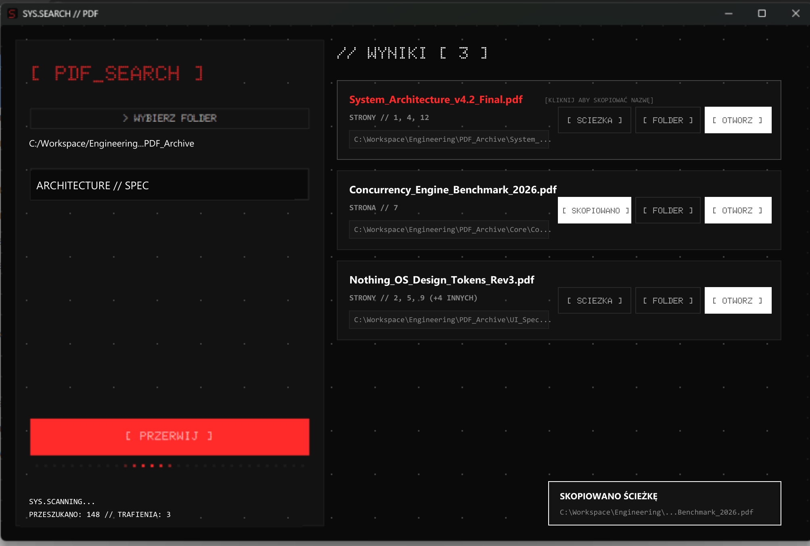
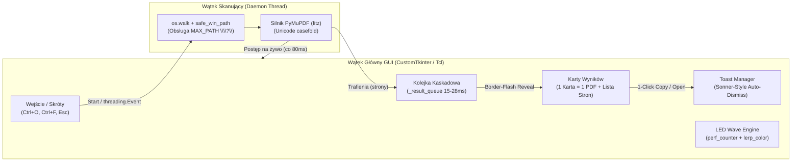

<div align="center">

```text
╔══════════════════════════════════════════════════════════════════╗
║  SYS.SEARCH // PDF — INDUSTRIAL DESKTOP DOCUMENT INDEXER         ║
╚══════════════════════════════════════════════════════════════════╝
```

# ModernPDFSearch `[ PDF_SEARCH ]`

**Ultraszybka, wielowątkowa aplikacja desktopowa do pełnotekstowego przeszukiwania dokumentów PDF, zaprojektowana w industrialnej estetyce Nothing OS / Cyber-Brutalism.**

[](LICENSE)
[](https://www.python.org/)
[-ff2a2a.svg?style=flat-square&labelColor=121212)](https://pymupdf.readthedocs.io/)
[](https://github.com/TomSchimansky/CustomTkinter)
[](#)

*Zero chmury. Zero indeksowania w tle. Natychmiastowe wyniki na tysiącach plików PDF.*

<br>



</div>

---

## ⚡ Dlaczego ModernPDFSearch?

Standardowe wyszukiwarki systemowe często pomijają zawartość plików PDF, wymagają ciężkiego indeksowania usług Windows Search lub zamrażają interfejs przy głębokich strukturach katalogów. **ModernPDFSearch** łączy natywną wydajność silnika C/C++ (`MuPDF`) z rzemiosłem projektowym inspirowanym **Nothing OS** oraz zasadami *Design Engineering* (Emil Kowalski / Apple Fluid Interfaces).

---

## 🔥 Mocne Strony Technologiczne (Engineering Highlights)

### 1. 🚀 Asynchroniczny Silnik I/O i Kolejka Kaskadowa (*Staggered Reveal Queue*)
- **Wielowątkowość bez blokad GIL UI:** Skanowanie operuje na odseparowanym wątku roboczym z atomową synchronizacją `threading.Event`, pozwalając na natychmiastowe przerwanie operacji (`Graceful Abort`) w dowolnej milisekundzie.
- **Kaskadowy bufor renderowania (`_drain_result_queue`):** Zamiast zalewać główną pętlę zdarzeń `Tcl/Tk` setkami wywołań naraz, aplikacja buforuje trafienia i wprowadza karty do widoku w adaptacyjnym rytmie **15–28 ms** z wejściowym efektem *border-flash* (`#ff2a2a` $\rightarrow$ `#444444` $\rightarrow$ `#222222`).
- **Ochrona zasobów GDI (`MAX_RESULTS = 500`):** Zabezpiecza proces przed przekroczeniem limitu 10 000 obiektów `USER/GDI` w systemie Windows (`WinError 1158`) przy szerokich zapytaniach.

### 2. 🎨 Matematycznie Zsynchronizowana Matryca Nothing OS (*Global Aligned Dot Grid*)
- **Siatka 1. planu (*Foreground Surface Matrix*):** Kropki nie są statycznym obrazkiem w tle — algorytm `draw_aligned_dots` wylicza globalny offset każdego kontenera względem okna głównego (`winfo_rootx`, `winfo_rooty`) ze wzoru fazowego:
  $$\text{offset}_{x} = (\text{spacing} - (\Delta x \bmod \text{spacing})) \bmod \text{spacing}$$
- Dzięki temu punkty matrycy przechodzą w **idealnej ciągłości geometrycznej** przez tło, panel boczny, przewijany obszar wyników oraz poszczególne karty dokumentów.

### 3. 🌊 Fizyka Ruchu oparta o Czas Rzeczywisty (*Delta-Time LED Marquee Wave*)
- **Zero narzutu Garbage Collectora:** Pasek postępu inicjalizuje prymitywy wektorowe Canvas tylko raz (`Object Pooling`) i modyfikuje wyłącznie ich atrybuty w pamięci przez `itemconfig`.
- **Fala Gaussowska LED (`time.perf_counter`):** Płynna fala świetlna (~33 FPS) z wygaszaniem ogona (*trail decay*) i liniową interpolacją barw HEX (`lerp_color`), całkowicie niezależna od obciążenia dysku I/O.

### 4. 🛡️ Pancerna Integracja z Systemem Windows (*Win32 Hardening*)
- **Prywatna rejestracja typografii GDI (`AddFontResourceExW`):** Czcionka matrycowa `Doto-Bold.ttf` jest ładowana bezpośrednio do pamięci procesu z flagami `FR_PRIVATE | FR_NOT_ENUM` (`0x10 | 0x20`) — aplikacja nie wymaga uprawnień administratora ani instalacji czcionek w systemie.
- **Obsługa `MAX_PATH > 260` znaków:** Automatyczna konwersja głębokich ścieżek korporacyjnych do składni rozszerzonej Win32 (`\\?\`), eliminująca błędy `FileNotFoundError [WinError 206]`.
- **Odporność na znaki specjalne i blokady:** Wywołania `explorer.exe /select` przekazywane jako bezpieczne tablice procesów (odporność na przecinki, spacje i znaki `&` w nazwach folderów), porównania tekstowe oparte o standard Unicode `.casefold()` oraz wczesna detekcja zaszyfrowanych plików PDF (`doc.needs_pass`).

---

## 🧠 Architektura Przepływu Danych



---

## ✨ Kluczowe Funkcjonalności UX

| Funkcja | Działanie | Szczegóły Techniczne |
| :--- | :--- | :--- |
| **Kopiowanie nazwy pliku (1-Click)** | Kliknij bezpośrednio na **tytuł pliku PDF** na karcie | Natychmiast kopiuje samą nazwę pliku do schowka, wyświetla potwierdzenie na tytule oraz pływający toast. |
| **Kopiowanie pełnej ścieżki** | Przycisk `[ ŚCIEŻKA ]` | Transformuje przycisk w miejscu kliknięcia na `[ SKOPIOWANO ]` (1.2s) i kopiuje pełny adres dyskowy. |
| **Lokalizacja w Eksploratorze** | Przycisk `[ FOLDER ]` | Otwiera Eksplorator Windows i automatycznie podświetla wskazany plik PDF na liście. |
| **Natychmiastowy podgląd** | Przycisk `[ OTWÓRZ ]` | Uruchamia dokument w domyślnym czytniku systemowym (`os.startfile`). |
| **Agregacja trafień per plik** | Wskaźnik `STRONY // 4, 12, 19 (+3)` | Grupuje wszystkie pasujące strony z jednego dokumentu na jednej czytelnej karcie. |
| **Telemetria na żywo** | Dolny pasek statusu | Wyświetla w czasie rzeczywistym liczbę przeskanowanych plików, trafień oraz pominiętych/zaszyfrowanych dokumentów. |

### ⌨️ Skróty Klawiszowe (*Keyboard-First Workflow*)

- <kbd>Ctrl</kbd> + <kbd>O</kbd> — Wybór katalogu źródłowego do przeszukania
- <kbd>Ctrl</kbd> + <kbd>F</kbd> — Natychmiastowy fokus i zaznaczenie tekstu w polu wyszukiwania
- <kbd>Enter</kbd> — Rozpoczęcie skanowania (gdy fokus znajduje się w polu frazy)
- <kbd>Esc</kbd> — Przerwanie trwającego skanowania lub wyczyszczenie pola wyszukiwania

---

## 🛠️ Instalacja i Uruchomienie ze Źródeł

### Wymagania
- **System:** Windows 10 / 11 (wspiera również macOS oraz Linux)
- **Python:** `3.10+` (przetestowano na `Python 3.12` oraz `3.14`)

### Szybki Start
```bash
# 1. Sklonuj repozytorium
git clone https://github.com/sergeapollonov/ModernPDFSearch.git
cd ModernPDFSearch

# 2. Utwórz i aktywuj środowisko wirtualne
python -m venv venv
venv\Scripts\activate

# 3. Zainstaluj zależności
pip install -r requirements.txt

# 4. Uruchom aplikację
python app.py
```

---

## 📦 Kompilacja do Samodzielnego Pliku `.exe`

Projekt zawiera kompletną konfigurację `ModernPDFSearch.spec` dla **PyInstaller**, która pakuje interpreter Pythona, silnik `MuPDF`, czcionkę `Doto-Bold.ttf` oraz ikonę `icon_nothing.ico` w pojedynczy plik wykonywalny typu *standalone* (niewymagający instalacji Pythona na komputerze docelowym).

```bash
pyinstaller --noconfirm ModernPDFSearch.spec
```
*(Alternatywnie uruchom skrypt dwuklikiem: `zbuduj_exe.bat`)*.  
Wynikowy plik znajdziesz w: `dist/ModernPDFSearch.exe`.

---

## 📂 Struktura Projektu

```text
ModernPDFSearch/
├── app.py                  # Kompleksowy kod aplikacji (Silnik I/O, GUI, Animacje, Win32 API)
├── ModernPDFSearch.spec    # Specyfikacja PyInstaller (bundling zasobów binarnych i fontów)
├── requirements.txt        # Zależności (customtkinter, PyMuPDF, pyinstaller)
├── zbuduj_exe.bat          # Automatyczny skrypt kompilacji dla systemu Windows
├── generate_assets.py      # Generator zasobów graficznych i ikony matrycowej (Pillow)
├── Doto-Bold.ttf           # Czcionka matrycowa Nothing Dot (ładowana do pamięci GDI)
├── icon_nothing.ico        # Wielorozdzielcza ikona aplikacji (256x256 -> 32x32)
├── LICENSE                 # Licencja MIT
└── README.md               # Dokumentacja techniczna
```

---

## 📄 Licencja

Ten projekt jest udostępniany na warunkach licencji **MIT** — szczegółowe informacje znajdują się w pliku [LICENSE](LICENSE). Możesz swobodnie używać, modyfikować i dystrybuować kod zarówno w projektach prywatnych, jak i komercyjnych.

---

<div align="center">

**Designed & Engineered by [sergeapollonov](https://github.com/sergeapollonov)**  
*Quiet tools, strong opinions on design.*

</div>
